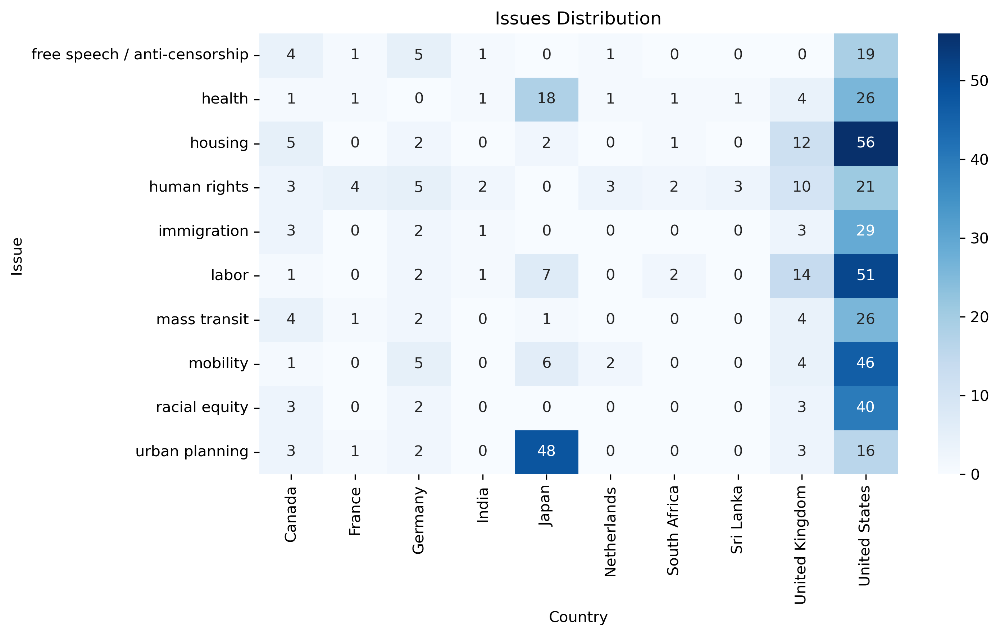
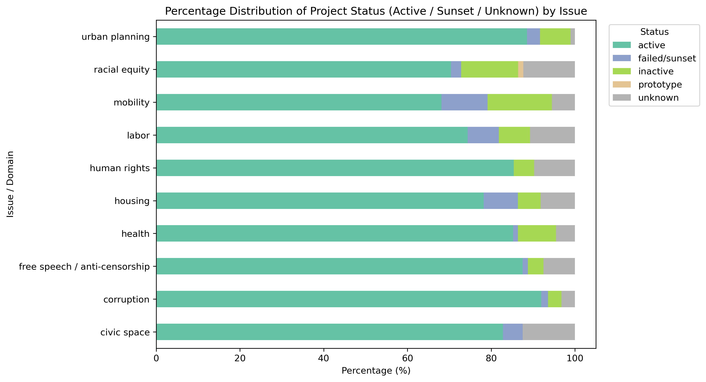
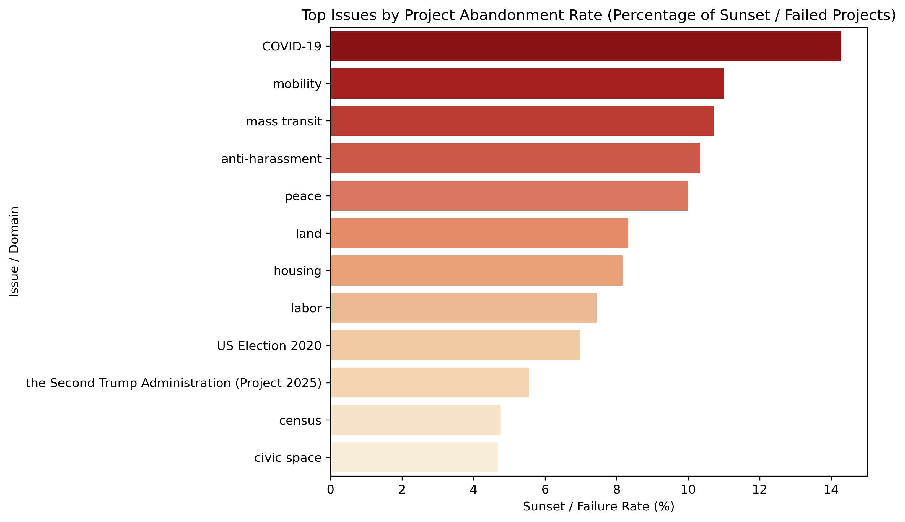
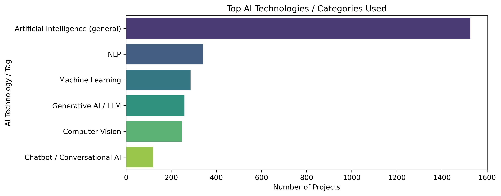
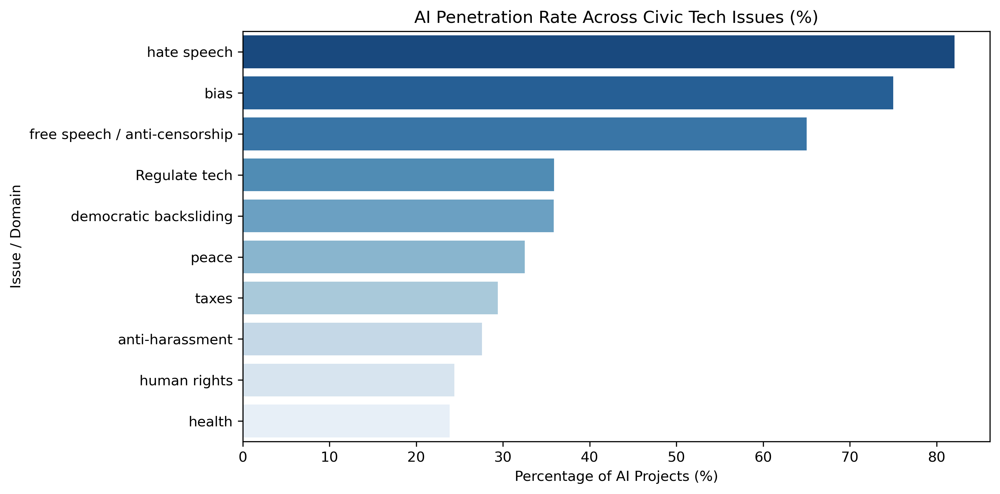

# Exploratory Data Analysis: `civictech_unified` Dataset

This repository contains the exploratory data analysis (EDA) notebook and summary findings for the `civictech_unified` dataset (DSSG Ecosystem Map — Germany & India). All scripts use relative paths (`civictech_unified.parquet` and `assets/`) so the workflow can be reproduced locally.

---

## 1. Issue Distribution Across Countries

A 2D cross-analysis of issues and countries highlights a strong geographic concentration in the current dataset:

* **Dominant Western coverage:** The **United States** and the **United Kingdom** account for the highest volume of projects across major civic domains (such as *housing*, *labor*, and *mobility*).
* **Underrepresentation of Germany and India:** Both **Germany** and **India** have relatively low representation in the heatmap compared to US and UK entries.
* **Thematic gaps:** In these collections, **India** shows zero recorded projects in domains such as *housing*, *urban planning*, *racial equity*, *mobility*, and *mass transit*. **Germany** shows zero recorded projects in *health*.
* **Coverage bias vs. real-world need:** Rather than indicating a lack of local relevance or urgency, these gaps largely reflect dataset coverage and source composition biases (such as English-language and Western-leaning source dominance).

---

## 2. Data Completeness & Missing Country Data by Source

A completeness check on key metadata fields (`issues`, `countries`, `geographic_focus`, `language`, and `status`) shows high structural completeness after preprocessing, with `language` having a small share of missing entries (3.38%) and `0.00%` missingness across the other evaluated fields.

Evaluating missing country data by contributing source (`missing_by_source`) confirms that country attributes are populated across the listed sources (`0.0%` missing country values in the evaluated breakdown), while overall project counts remain heavily skewed toward **CTFG**.

=== 1. MISSING VALUES IN KEY FIELDS ===
                  missing_count  missing_percentage
language                    490                3.38
issues                        0                0.00
countries                     0                0.00
geographic_focus              0                0.00
status                        0                0.00

==================================================

=== 2. MISSING COUNTRY DATA BY SOURCE ===
            sources  total_projects  missing_countries  missing_pct
 Awesome-Civic-Tech              34                  0          0.0
               CTFG           13329                  0          0.0
       CivicDataLab            1068                  0          0.0
CivicTechFundAfrica              36                  0          0.0
          CodeForDE             248                  0          0.0
               HIIG             209                  0          0.0
     HackCorruption               4                  0          0.0
| sources             |   total_projects |   missing_countries |   missing_pct |
|:--------------------|-----------------:|--------------------:|--------------:|
| Awesome-Civic-Tech  |               34 |                   0 |             0 |
| CTFG                |            13329 |                   0 |             0 |
| CivicDataLab        |             1068 |                   0 |             0 |
| CivicTechFundAfrica |               36 |                   0 |             0 |
| CodeForDE           |              248 |                   0 |             0 |
| HIIG                |              209 |                   0 |             0 |
| HackCorruption      |                4 |                   0 |             0 |
---

## 3. Project Status Distribution (`Active`, `Inactive`, `Failed/Sunset`, `Unknown`)

### Percentage Status Breakdown by Issue
Across all major issue domains, the **majority of projects are `active`**. However, noticeable shares of `inactive`, `failed/sunset`, and `unknown` projects appear depending on the domain.

### Non-Active & Abandoned Projects Breakdown
Looking specifically at non-active and unknown projects:

* **Source distribution:** **CTFG** accounts for the largest volume of `failed/sunset`, `inactive`, and `unknown` entries.
* **Country distribution:** The **United States** ranks first in non-active/abandoned projects in absolute terms, followed by **Germany**—notable given Germany's smaller overall project count compared to the US.
* **Why projects get abandoned:**
  * **Crisis-driven & time-bound topics (e.g., COVID-19):** Many initiatives declined or closed once the acute emergency phase subsided—even though ongoing pandemic preparedness and resilience plans remain essential.
  * **Infrastructure & operational sustainability (e.g., `mobility` and `mass transit`):** Some topics lose momentum over time ("have had their day"), while others likely struggle due to ongoing maintenance, data/API upkeep, and **lack of sustained funding**.

---

## 4. AI Penetration Across Civic Issues

AI-related initiatives are unevenly distributed across civic domains:

* **High concentration in language & discourse:** AI penetration is highest in text- and language-heavy areas such as **hate speech**, **bias**, and **free speech / anti-censorship**, aligning with strong usage of **NLP** and text/language approaches.
* **Lower penetration in `health` and `taxes`:** Domains like **health** and **taxes** show lower AI penetration, largely due to **sensitive, restricted, or confidential data** as well as reliance on **more traditional administrative methods and workflows**.

